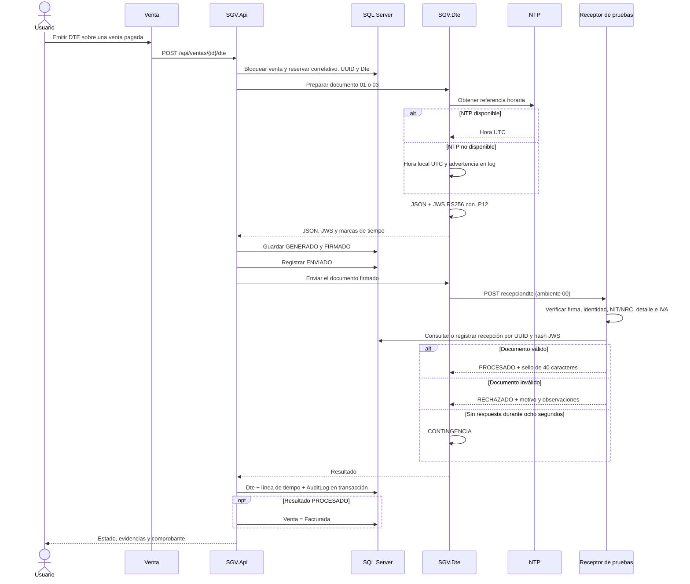

# Proceso de facturación electrónica

## Alcance y componentes

El flujo se ejecuta íntegramente con **SGV.ReceptorPruebas**, un receptor propio en ambiente `00`. Los comandos de esta documentación no utilizan servicios de Hacienda. El encabezado y los comprobantes identifican el **Ambiente de pruebas**.

| Componente          | Puerto local Docker | Responsabilidad                                                      |
| ------------------- | ------------------: | -------------------------------------------------------------------- |
| React / Nginx       |                5173 | Emisión, consulta, indicadores, comprobante y QR                     |
| SGV.Api             |                5080 | Autorización, venta pagada, correlativos, persistencia y auditoría   |
| SGV.Dte             |                5081 | JSON fiscal, NTP, firma JWS y transporte con límite de ocho segundos |
| SGV.ReceptorPruebas |                5082 | Firma, validaciones fiscales de pruebas, respuesta e idempotencia    |
| SQL Server 2022     |               14338 | Ventas, pagos, `Dte`, `ReceptorDte` y `AuditLog`                     |

### Secuencia



## Tipos y cálculo

- **Factura 01, versión 1:** consumidor final sin NRC. Los precios y la venta gravada incluyen IVA. `ivaItem = redondear(ventaGravada × 13 / 113, 2)` y `resumen.totalIva` suma el IVA de las líneas.
- **CCF 03, versión 3:** receptor con NRC. Los precios son base sin IVA; el tributo `20` es `redondear(totalGravada × 0.13, 2)`. Total = base + IVA.
- **Nota de Crédito 05, versión 3:** corrección total de un CCF 03 procesado y vigente. `documentoRelacionado` referencia el UUID del CCF original. La nota utiliza su propio contrato: el total es `resumen.montoTotalOperacion`, sin agregar campos propios de Factura/CCF.

La generación conserva el importe de la venta pagada para que el receptor detecte una eventual inconsistencia con el detalle. Los cálculos utilizan `decimal` y redondeo a dos decimales; el precio unitario con IVA conserva hasta ocho decimales. El UUID es v4 en mayúsculas y el número de control tiene formato `DTE-01-M001P001-000000000000001`, con correlativo transaccional por establecimiento.

Se consultaron las estructuras 01 v1, 03 v3 y 05 v3 del conjunto de referencia público [svfe-json-schemas, revisión 1e7a0d9](https://github.com/hherzl/InvoizR/tree/1e7a0d9df3cb3415fcede25c38e1988c9ac82656/Resources/MH/svfe-json-schemas). **Antes de producción debe contrastarse contra el esquema oficial vigente**, sus catálogos, autenticación, algoritmos admitidos y requisitos de certificación. El comentario también está presente en el generador y el evento de invalidación.

## Firma y receptor

La preparación genera un certificado RSA .P12 de pruebas y exporta únicamente su certificado público `.cer` para el receptor. El JWS compacto contiene encabezado, payload y firma; el receptor solo admite `RS256` y el identificador del certificado público configurado. No obtiene claves del encabezado recibido.

El receptor comprueba los campos obligatorios, ambiente, versión/tipo, UUID, control, fecha/hora, moneda, NIT de 14 o 9 dígitos, NRC numérico, líneas, descuentos, totales e IVA. Se valida el formato de los identificadores, sin consultar registros tributarios externos.

Respuesta procesada:

```json
{
  "version": 1,
  "ambiente": "00",
  "versionApp": "SGV.ReceptorPruebas/1.0.0",
  "estado": "PROCESADO",
  "codigoGeneracion": "4B241E88-9383-4875-96A4-A9436F851CEC",
  "selloRecibido": "8A3C0B4D6E8F10293847AABBCCDDEEFF00112233",
  "fhProcesamiento": "06/11/2026 10:30:00",
  "clasificaMsg": "10",
  "codigoMsg": "001",
  "descripcionMsg": "RECIBIDO",
  "observaciones": []
}
```

En un rechazo se devuelve `estado: RECHAZADO`, `codigoMsg`, `descripcionMsg` y observaciones como `NIT DEL RECEPTOR NO VÁLIDO` o `TOTAL NO COINCIDE CON EL DETALLE`. No se asigna sello.

La latencia normal es aleatoria entre 300 y 900 ms. La inyección `timeout-once`, habilitada solo para las pruebas, retrasa el primer intento 9.5 segundos: el cliente corta a los ocho segundos. El siguiente intento utiliza la latencia normal.

### Configuración

| Variable / appsettings                             | Función                                                                                     |
| -------------------------------------------------- | ------------------------------------------------------------------------------------------- |
| `Receiver__Url` / `Receiver:Url`                   | URL completa de recepción; Docker: `http://receptor:8080/api/receptor-pruebas/recepciondte` |
| `Receiver__InvalidationUrl`                        | URL opcional para invalidaciones; por defecto se deriva de la recepción                     |
| `Receiver__TimeoutSeconds`                         | Límite de recepción, predeterminado y máximo: 8 segundos                                    |
| `Receiver__Token` o `DTE_AUTHORITY_TOKEN`          | Bearer configurable cuando el receptor compatible lo requiere                               |
| `DTE_CERTIFICATE_PATH`, `DTE_CERTIFICATE_PASSWORD` | Certificado privado de pruebas y su contraseña                                              |
| `DTE_PUBLIC_CERTIFICATE_PATH`                      | Certificado público que fija la confianza del receptor                                      |
| `DTE_SERVICE_KEY`                                  | Autenticación entre los servicios de pruebas                                                |
| `Ntp__Host`, `Ntp__Port`                           | Servidor horario; si no responde se registra una advertencia y se utiliza UTC local         |

La URL se cambia por configuración, sin recompilar el transporte. Para los comandos y la demostración se mantiene exclusivamente el receptor propio.

## Estados e integridad

| Estado de Dte | Significado                                       | Estado de la venta                        |
| ------------- | ------------------------------------------------- | ----------------------------------------- |
| GENERADO      | Identificadores reservados y preparación en curso | Pagada                                    |
| FIRMADO       | JSON y JWS guardados                              | Pagada                                    |
| ENVIADO       | Solicitud enviada al receptor                     | Pagada                                    |
| PROCESADO     | Respuesta válida y sello persistidos              | Facturada, excepto notas de crédito       |
| RECHAZADO     | El receptor rechazó el contenido                  | Pagada                                    |
| CONTINGENCIA  | No se confirmó la recepción                       | Pagada; permite Reenviar                  |
| INVALIDADO    | El receptor confirmó la invalidación              | Pagada; permite emitir un documento nuevo |

`Dte` conserva JSON, JWS, respuesta, sello, tipo, UUID, control, fechas, intentos, versión y línea de tiempo. El resultado final, el estado de venta y `AuditLog` se actualizan en una misma transacción. El usuario del evento proviene de la sesión autenticada.

Los reenvíos conservan UUID, control, JSON y firma. `ReceptorDte` guarda la respuesta por UUID y hash JWS: un envío repetido devuelve el mismo sello y un contenido distinto con el mismo UUID se rechaza. La reserva impide emitir dos facturas activas para la misma venta.

### Correcciones

- `POST /api/dte/{id}/invalidacion`, con `{ "motivo": "Corrección de receptor" }`: firma el evento, obtiene la respuesta y registra el resultado. Solo cambia a INVALIDADO tras confirmación. Si la invalidación queda en contingencia, el documento mantiene su estado y se reintenta con el motivo y evento originales.
- `POST /api/dte/{id}/nota-credito`: emite una nota total 05 que referencia un CCF 03 procesado. Es idempotente por documento original. No se permite invalidar el CCF mientras tenga una nota asociada.

## Consulta, comprobante e indicadores

La pantalla permite filtrar por fecha, tipo y estado y exportar CSV. El límite de consulta es de 1000 documentos; al superarlo se solicita reducir el rango para evitar exportaciones truncadas.

Los indicadores se calculan desde los registros `Dte` del filtro seleccionado: total emitidos, porcentaje procesado, porcentaje rechazado, motivos de rechazo más frecuentes, contingencias y tiempo promedio entre el inicio de emisión y la respuesta. Las contingencias sin respuesta no se incluyen en ese promedio.

El comprobante muestra identificación, emisor, receptor, detalle, IVA, total y sello. Su QR apunta a `/consulta/dte/{codigoGeneracion}` dentro de SGV-Comercial. La consulta expone estado, control, sello, fecha e importe y omite los datos personales del receptor.

## Levantar la demostración con Docker

Requisitos: Docker Desktop/Compose y Node.js 22. La primera construcción descarga las imágenes y dependencias; se realiza antes del recorrido de tres minutos.

```bash
git switch feature/SGV-38-flujo-dte-completo
bash scripts/demo.sh up
bash scripts/demo.sh credentials
```

Abre **http://localhost:5173**. Usuario: `admin`. El comando `credentials` muestra la contraseña generada; los secretos y certificados se guardan exclusivamente en `.local/`, fuera de Git.

La preparación crea **35 ventas pagadas: cinco principales y treinta adicionales**. Incluye un NIT inválido en las principales y, en las adicionales, dos NIT inválidos y un total inconsistente. Emite mediante el flujo completo las primeras 24 adicionales para poblar indicadores con resultados del receptor. Los cinco casos `DEMO-001` a `DEMO-005` permanecen disponibles para la presentación.

| Caso principal | Tipo / comportamiento                                        |
| -------------- | ------------------------------------------------------------ |
| DEMO-001       | Factura 01 válida                                            |
| DEMO-002       | Receptor con NIT inválido → RECHAZADO                        |
| DEMO-003       | CCF 03 válido; permite mostrar Nota de Crédito               |
| DEMO-004       | Primera recepción lenta → CONTINGENCIA; Reenviar → PROCESADO |
| DEMO-005       | Factura 01 adicional para invalidación                       |

```bash
# Detener sin perder la base
bash scripts/demo.sh down

# Reiniciar exclusivamente los datos de esta demostración
bash scripts/demo.sh reset
bash scripts/demo.sh up
```

Para desarrollar con .NET SDK 8 y Vite, manteniendo SQL Server en Docker:

```bash
bash scripts/native-demo.sh up
npm ci --ignore-scripts
npm run dev
# Al terminar:
bash scripts/native-demo.sh down
```

`DOTNET_BIN` permite seleccionar una instalación específica del SDK. `SGV_NATIVE_OFFSET` permite desplazar los puertos para una verificación aislada.

## Pruebas

```bash
# SQL Server local de la demostración
source .local/demo.env
export SGV_TEST_SQL="Server=localhost,14338;User Id=sa;Password=$SGV_SQL_PASSWORD;Encrypt=True;TrustServerCertificate=True"
dotnet test tests/SGV.Tests/SGV.Tests.csproj --configuration Release
npm test

# Navegador contra la API, firma y receptor iniciados
SGV_E2E_FULLSTACK=1 SGV_E2E_PASSWORD="$SGV_ADMIN_PASSWORD" npm run test:e2e
```

CI inicia SQL Server 2022, aplica las migraciones, genera certificados privados para la ejecución, ejecuta xUnit, inicia los tres servicios y ejecuta Playwright desde “Emitir DTE” hasta PROCESADO. Publica TRX, cobertura y reporte de navegador y envía el análisis a SonarQube Cloud.

Las pruebas `CP_DTE_03_JsonCumpleEstructura`, `CP_DTE_05_SeleccionTipoDte`, `CP_DTE_09_FirmaVerificable`, `CP_DTE_14_CodigoGeneracionUnico`, `CP_DTE_18_ReceptorInvalidoEsRechazado`, `CP_DTE_23_ReceptorSinRespuestaQuedaEnContingencia`, `CP_DTE_27_InvalidacionDte` y `CP_DTE_28_NotaCreditoReferenciaOriginal` cubren los casos solicitados. La prueba unitaria de timeout inyecta un plazo más corto; la demostración utiliza los ocho segundos configurados.

## Guion de demostración: tres minutos

| Tiempo    | Acción y evidencia                                                                                                                                                      |
| --------- | ----------------------------------------------------------------------------------------------------------------------------------------------------------------------- |
| 0:00–0:25 | Iniciar sesión, abrir **Facturación electrónica** y señalar “Ambiente de pruebas”, indicadores y motivos de rechazo.                                                    |
| 0:25–1:05 | Buscar **DEMO-001**, pulsar **Emitir DTE**, mostrar Generado → Firmado → Enviado → PROCESADO, UUID, control y sello de 40 caracteres. Abrir comprobante y su enlace QR. |
| 1:05–1:40 | Buscar **DEMO-002** y emitir. Mostrar **RECHAZADO**, “NIT DEL RECEPTOR NO VÁLIDO” y que la venta continúa **Pagada**.                                                   |
| 1:40–2:25 | Buscar **DEMO-004**, emitir y esperar ocho segundos. Mostrar **CONTINGENCIA** y el botón **Reenviar**. Reenviar y comprobar PROCESADO con el mismo UUID y control.      |
| 2:25–3:00 | Filtrar documentos por tipo/estado, exportar CSV y señalar la actualización de indicadores. Mostrar las evidencias de CI/Sonar.                                         |

Extensión fuera del recorrido principal: emitir **DEMO-003** y su nota de crédito; emitir **DEMO-005** e invalidarla con un motivo. Usar documentos distintos para ambas correcciones.
